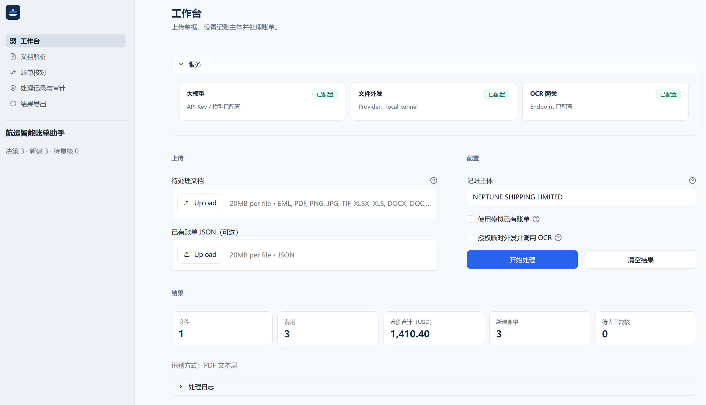
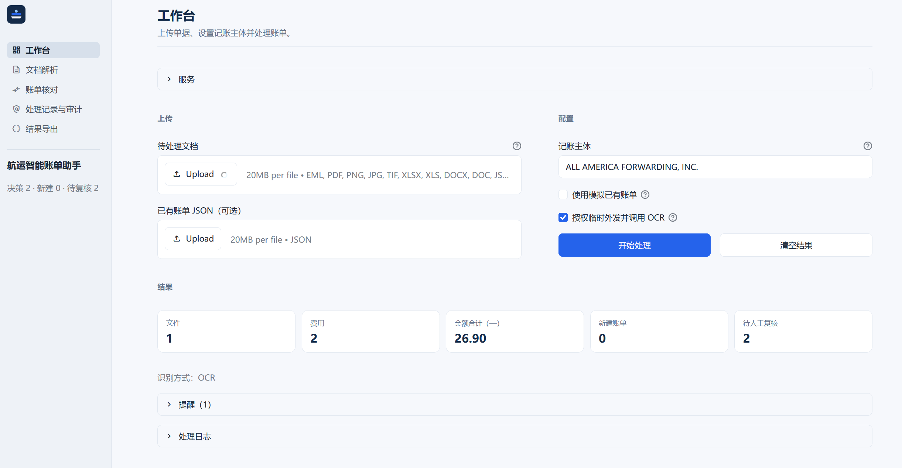

# 航运智能账单助手 · Shipping Billing AI

面向航运 / 国际货代财务场景的 **Python + LangChain AI Agent** 笔试工程：多格式单据解析、题目指定 OCR、结构化费用提取、账单匹配与 CREATE / UPDATE / NO_CHANGE / PENDING_REVIEW、AR/AP 判断、标准 JSON 输出，以及 **Streamlit** 五页中文可视化。

本仓库强调可运行、可测试、可解释；不以静态页面或硬编码结果冒充业务能力。

**快速安装与启动：** 请直接打开 [`Quick Start/`](Quick%20Start/) 文件夹——Windows 双击 `1_Install.bat` → 编辑 `.env` → `2_Start.bat`；macOS 使用对应的 `.command` 文件。说明见 [`Quick Start/README.md`](Quick%20Start/README.md)。

---

## 1. 项目介绍与核心功能

- 解析 EML / PDF / PNG / JPG / TIFF / XLS / XLSX / DOCX（旧版 DOC 需 LibreOffice）
- 调用招聘方 OCR：`https://gateway.pltplt.com/ai/process`
- LangChain 单 Agent 结构化提取（证据块 + grounding）
- 确定性财务规则：费用标准化、四级匹配、更新白名单、AR/AP、校验
- Streamlit：工作台 / 文档 / 账单核对 / 审计 / JSON 下载

---

## 2. 技术架构

```
上传 → 安全校验 → 魔数识别 → 解析器
     → FileUrlProvider（可选）→ OCR API（origin=ocr_api）
     → LangChain ExtractionAgent（工具 + 结构化输出）
     → 标准化 / 匹配 L1–L4 / AR·AP / 决策 / 校验
     → 标准 JSON + Streamlit 五页
```

原则：**LLM 负责语义与证据；入账 operation / AR·AP 由 Python 规则决定。**

详见 [`docs/architecture.md`](docs/architecture.md)、[`docs/assumptions.md`](docs/assumptions.md)。

---

## 3. LangChain Agent 设计

- 单一 Extraction Agent
- 只读工具：按 `block_id` 回查原文 / 表格
- Structured Output：优先兼容 OpenAI 风格；DeepSeek 思考模式需关闭
- Grounding：字段须能回指文档；无法确认 → `null` / `PENDING_REVIEW`
- `change_requests` 仅在文档有**明确修改指令**且证据可核验时保留

---

## 4. DeepSeek 接入

在 `.env` 中配置 OpenAI 兼容接口，例如：

```env
LLM_BASE_URL=https://api.deepseek.com
LLM_MODEL=deepseek-flash
LLM_API_KEY=你的密钥
LLM_THINKING=disabled
```

`LLM_THINKING=disabled` 避免 thinking 与 `tool_choice=required` 冲突（Agent 工具调用需要）。

---

## 5. 多格式文档解析

| 格式 | 说明 |
|------|------|
| EML | 头 / 正文（纯文本+HTML）/ 附件；嵌套深度限制 |
| PDF | 文本层 + 表格；扫描页走 OCR |
| PNG/JPG/TIFF | 无文本层，依赖 OCR |
| XLS/XLSX | 工作表行 |
| DOCX | 段落 + 表格 |
| DOC | 经 LibreOffice 转换；未安装则明确失败 |
| JSON | 已有账单，用于匹配 |

---

## 6. OCR 与 LocalTunnel

题目 OCR 需要可公网访问的 `file` URL。本项目提供三种 FileUrlProvider：

| Provider | 用途 | 对招聘方 OCR |
|----------|------|----------------|
| **`local_tunnel`** | 本机受控文件网关 + Cloudflare **Quick Tunnel** | **已真实通过**（笔试演示路径） |
| `aliyun_oss` | 私有桶签名 URL | 历史 **HTTP 504** |
| `cloudflare_r2_worker` | 私有 R2 + HMAC Worker | 历史 **HTTP 504** |

**必须理解：**

- LocalTunnel 是**已通过真实 OCR 测试**的笔试 / 开发演示路径。
- Cloudflare Quick Tunnel **不是**生产级托管：无 SLA、主机名每次启动变化、关闭后旧 URL 立即失效。
- Tunnel **必须在本地保持运行**；Streamlit 才能成功外发 OCR。
- **不要**把动态 Tunnel 地址写进 README 或提交到 Git。
- 真实业务文件上传第三方服务前需要**明确授权**。
- 未勾选 OCR 授权时，PDF 仍可用 **text_layer**（UI 不得标为 OCR 成功）。

操作说明：[`docs/local_tunnel_provider.md`](docs/local_tunnel_provider.md)。

---

## 7. 财务业务规则

- 费用名标准化（字典 + 别名）
- 匹配优先级 **L1 → L4**；多候选且无法非金额消歧 → `PENDING_REVIEW`
- UPDATE 仅改有证据字段；禁止整对象覆盖
- AR/AP：基于 **accounting_entity** + 付款方向证据（Please Pay / BENEFICIARY / CONSIGNEE 等），**不单凭** Debit/Credit Note
- `$` 不自动变 USD；币种缺失 → 阻塞 / 待复核
- 证据不足时宁可 `PENDING_REVIEW`，不为追求自动化率强行入账

---

## 8. Streamlit 五个页面

| 页面 | 作用 |
|------|------|
| 智能工作台 | 上传、记账主体、OCR 授权、运行 Pipeline、KPI |
| 文档解析中心 | 结构 / 文本层 / OCR / 提取字段与证据 |
| 账单核对中心 | 操作类型、费用、AR/AP、前后对比 |
| AI 决策与审计 | 阶段时间线、工具摘要、决策依据 |
| JSON 结果中心 | Schema 校验、预览、下载 |

演示模式勾选「使用模拟已有账单」时：**Pipeline 仍真实执行**，账本为合成 fixture（`_synthetic: true`）。

### 人工验收截图（版本库内）

[`screenshots/`](screenshots/) 是正式人工验收证据目录（**纳入 Git**，勿整体加入 `.gitignore`），含五个子目录：`PDF1` / `PDF2` / `EML` / `PNG` / `Synthetic`。完整截图保留作走查证据；下列为代表性引用（其余见各子目录）：

| 场景 | 文件 |
|------|------|
| PDF 文本层工作台 | [`PDF2/01_pdf2_workbench.png`](screenshots/PDF2/01_pdf2_workbench.png) |
| PDF JSON 导出 | [`PDF2/06_pdf2_json.png`](screenshots/PDF2/06_pdf2_json.png) |
| PNG 真实 OCR | [`PNG/13_png_workbench.png`](screenshots/PNG/13_png_workbench.png) |
| PNG 待复核核对 | [`PNG/15_png_result.png`](screenshots/PNG/15_png_result.png) |
| 合成 CREATE | [`Synthetic/16_create_ar.png`](screenshots/Synthetic/16_create_ar.png) |





提交前须检查截图中无密钥、访问令牌、完整临时 Tunnel / 签名 URL。

---

## 9. 安装与依赖

要求：Windows 10/11 或 macOS、**Python 3.11+**、可访问 DeepSeek 与 OCR 网关。

### 推荐：Quick Start 双击脚本

目录：[`Quick Start/`](Quick%20Start/)

| 步骤 | Windows | macOS |
|------|---------|-------|
| 安装 venv + 依赖 + 官方 cloudflared + `.env` | `1_Install.bat` | `1_Install.command` |
| 启动 LocalTunnel + Streamlit | `2_Start.bat` | `2_Start.command` |
| 停止本会话 | `3_Stop.bat` | `3_Stop.command` |

安装后编辑根目录 `.env`（至少 `LLM_API_KEY`）。说明见 [`Quick Start/README.md`](Quick%20Start/README.md)。

`cloudflared` 仅从 **Cloudflare GitHub Releases** 下载到 `tools/`；勿替换为不明来源二进制。

### 手动安装（等价）

```powershell
cd <本项目目录>
python -m venv .venv
.\.venv\Scripts\Activate.ps1
pip install -r requirements.txt
copy .env.example .env
# 编辑 .env：填入 LLM_* ；FILE_URL_PROVIDER=local_tunnel
```

可选：安装 LibreOffice 以支持旧版 `.doc`（`SOFFICE_PATH`）。

---

## 10. 环境变量（摘要）

见 [`.env.example`](.env.example)。关键项：

| 变量 | 说明 |
|------|------|
| `LLM_API_KEY` / `LLM_MODEL` / `LLM_BASE_URL` | DeepSeek 等 |
| `LLM_THINKING` | 建议 `disabled` |
| `OCR_ENDPOINT` | 默认题目地址 |
| `FILE_URL_PROVIDER` | 笔试用 `local_tunnel` |
| `LOCAL_TUNNEL_*` | 可由一键启动写入会话；Provider 也会读 `output/local_tunnel/status.json` |

**不要提交** `.env`、API Key、Token、真实客户账单。

---

## 11. 一键启动（推荐）

**最简单：** 双击 [`Quick Start/2_Start.bat`](Quick%20Start/2_Start.bat)（Windows）或 `2_Start.command`（macOS）。

等价 PowerShell（Windows）：

```powershell
.\scripts\demo\Start-ExamDemo.ps1
```

脚本会：

1. 检查 `.venv`、依赖、`tools/cloudflared(.exe)`、`.env`（不打印密钥）
2. 停止**本项目**上次会话进程（不误杀其他 cloudflared/Python）
3. 删除过期 `status.json`，启动新的 LocalTunnel（新 HTTPS 主机名）
4. 本地 + 公网 `/health` 检查
5. 启动 Streamlit（默认 `http://localhost:8501`）

停止：双击 `Quick Start/3_Stop.bat` / `3_Stop.command`，或：

```powershell
.\scripts\demo\Stop-ExamDemo.ps1
```

会清理本会话 PID、删除 Tunnel `status.json`，防止复用失效 URL。

---

## 12. 手动启动与停止

```powershell
# 终端 A：Tunnel
.\.venv\Scripts\python.exe scripts\local_tunnel\start_gateway.py

# 终端 B：UI
.\.venv\Scripts\streamlit run app.py

# 停止 Tunnel
.\.venv\Scripts\python.exe scripts\local_tunnel\stop_gateway.py
# 或使用统一停止
.\scripts\demo\Stop-ExamDemo.ps1
```

每次重启 Tunnel 后公网地址会变；以新的 `output/local_tunnel/status.json` 为准。

---

## 13. 合成样例测试流程

样例目录：[`data/samples/synthetic_exam/`](data/samples/synthetic_exam/)（**无客户数据**）。

1. 一键启动后打开 `http://localhost:8501`
2. **CREATE + AR**：上传 `exam_debit_create.pdf`；记账主体填 `NEPTUNE SHIPPING LIMITED`；可勾选 OCR（合成件）；关闭「模拟已有账单」；开始处理 → 期望 CREATE + AR
3. **CREATE + AP**：同一 PDF；主体改为 `ACME FREIGHT CONSIGNEE LLC` → CREATE + AP
4. **NO_CHANGE**：关闭模拟账本；上传 PDF + `existing_bills_no_change.json` → NO_CHANGE
5. **PENDING_REVIEW（金额差、无修订句）**：上传 `exam_debit_create.pdf` + `existing_bills_update.json`（账本 100，单据 125.50，无 amend 句）→ PENDING_REVIEW；对比应能看到 100 → 125.50
6. **UPDATE**：关闭「模拟已有账单」；上传 `exam_debit_amend.pdf` + `existing_bills_update.json`；主体 `NEPTUNE SHIPPING LIMITED` → 期望 UPDATE（amount 100→125.50）。单据含明确 amend 句；规则会规范化模型可能写出的 `HANDLING CHARGE amount` / `125.50 USD` 别名。侧栏「演示模式」仅表示账本带 `_synthetic` 标记，**不等于**误用了默认模拟账本
7. 在 **JSON 结果中心** 校验并下载

自动化（控制 OCR 次数，默认不走 OCR）：

```powershell
.\.venv\Scripts\python.exe scripts\demo\pipeline_decision_acceptance.py
```

真实 OCR（消耗配额，需 Tunnel 已启动）：

```powershell
.\.venv\Scripts\python.exe scripts\final_exam_acceptance.py
```

---

## 14. 自动化测试

```powershell
# 默认单元（不外呼）
.\.venv\Scripts\python.exe -m pytest tests/unit -q

# Streamlit 冒烟
.\.venv\Scripts\python.exe -m pytest tests/integration/test_streamlit_app.py -q

# 真实 LLM（需密钥）
.\.venv\Scripts\python.exe -m pytest tests/integration/test_real_llm_extraction.py --run-real -v
```

验收矩阵：[`docs/exam_ocr_acceptance_matrix.md`](docs/exam_ocr_acceptance_matrix.md)。

---

## 15. JSON 输出示例

六字段块（枚举保持英文）：

```json
{
  "operation": "CREATE",
  "document_info": {
    "document_type": "DEBIT NOTE",
    "reference_no": "DC-FINAL-9001",
    "document_date": null
  },
  "transaction_party": {
    "issuer": "NEPTUNE SHIPPING LIMITED",
    "recipient": "ACME FREIGHT CONSIGNEE LLC"
  },
  "charge_details": {
    "charge_item": "Handling Charge",
    "amount": 125.5,
    "currency": "USD",
    "payment_term": null
  },
  "financial_attributes": {
    "accounting_entity": "NEPTUNE SHIPPING LIMITED",
    "posting_type": "AR"
  },
  "audit_trail": {
    "ai_reasoning": [
      "CREATE: valid charge with no unique existing match",
      "entity matches payment-direction payee evidence ['NEPTUNE SHIPPING LIMITED']"
    ]
  }
}
```

---

## 16. 已知限制

1. **ZIM PNG 样例**：OCR 网关响应未返回可靠币种字段时，系统保持 `currency=null`，并输出 `PENDING_REVIEW`，**不**无证据推断为 USD。费用金额等其它 OCR 字段在 LocalTunnel 路径下已真实通过。
2. **阿里云 OSS 签名 URL** 与 **Cloudflare R2 Worker URL** 调用指定 OCR API 时存在 **HTTP 504** 兼容性问题；当前仍不宜作为主路径。
3. **已验证可工作的 OCR 路径**：`LocalTunnelProvider`（本机文件网关 + Cloudflare Quick Tunnel）。
4. **Quick Tunnel 仅用于开发与演示**，不是生产级文件托管：无 SLA、公网主机名每次启动变化、关闭后旧 URL 立即失效；**不要**写死 `trycloudflare.com` 地址。
5. **旧版 DOC** 解析依赖本机 **LibreOffice**（`SOFFICE_PATH`）；未安装时明确失败。
6. **Excel / Word**：已有解析器与自动化测试；**未**全部完成真实人工截图验收。
7. **PDF 文本层** 与 **真实 OCR** 是不同处理路径。未勾选 OCR 授权时，PDF 可走 text_layer，UI **不得**标成 OCR 成功。
8. **JSON Schema 校验成功** 只说明结构合法，**不代表**所有业务字段都无不确定性；缺币种、收付款方向或修订证据时允许 `PENDING_REVIEW`。
9. OCR 可能不回显自定义 MBL；有 text_layer 证据可用，**禁止凭空补造**。

---

## 17. 设计思考（业务 / 技术）

这些点可以收成三件事：

1. **防幻觉**：没在原文里出现的金额、币种、单号，一律不猜；入账结论也不交给模型一句定。
2. **人工 double check**：对不上、说不清、证据不够 → PENDING，把冲突和原因留下给人审。
3. **安全**：上传类型/大小、邮件嵌套深度要限住；密钥和真实账单不外泄；Mock 只用于测试。

具体做法如下。

### 业务侧

1. **AR/AP**：看「我们是谁、钱往哪边走」，不看 Debit/Credit 标题；吃不准就挂起。
2. **匹配**：优先单号、提单号、交易方；不拿金额当唯一对账钥匙。
3. **UPDATE**：只改对方明确要求改的字段；解释不了的差异先不自动改。
4. **冲突与缺失**：正文/附件打架记审计；OCR 没给出的字段保持空，不脑补。

### 技术侧

5. **Harness**：AI 只读懂和抽字段；新建/更新/不动/待审与校验用 Python 规则。
6. **输出稳定**：精确金额运算 + 固定 JSON 结构 + 规则拦截，原因写进审计。
7. **OCR 诚实**：外链失败如实说；验收不用假 OCR 冒充成功。
8. **安全**：限制上传与嵌套深度；演示走真管线、合成账本，不另做假页面。

---

## 18. 交付与安全

**应保留并提交（Public）：** 源码、`tests/`、`docs/`、`data/samples/`（招聘方已授权公开的原始 PDF/EML/PNG）、`data/fixtures/synthetic/`、`.env.example`、`Quick Start/`、**`screenshots/`（26 张人工验收截图）**、`workers/ocr-file-proxy/`。

**禁止提交：** `.env`、真实 API Key / Token、`output/` 运行产物、`.venv/`、`tools/cloudflared(.exe)`、Tunnel `status.json` / `env.snippet`、完整签名 URL、临时 Quick Tunnel 公网地址。

**截图：** `screenshots/` 纳入版本控制；提交前扫描无密钥与完整临时 URL；**不要**将整个 `screenshots/` 写入 `.gitignore`。

**测试口径（以最新本地运行为准）：** `tests/unit` → 185 passed；全量 `tests/` → 188 passed、12 skipped（外呼类按设计跳过，不得写成 passed）。

本仓库根目录必须是本项目目录本身，不要在磁盘根或其他无关 Git 仓库中提交。
