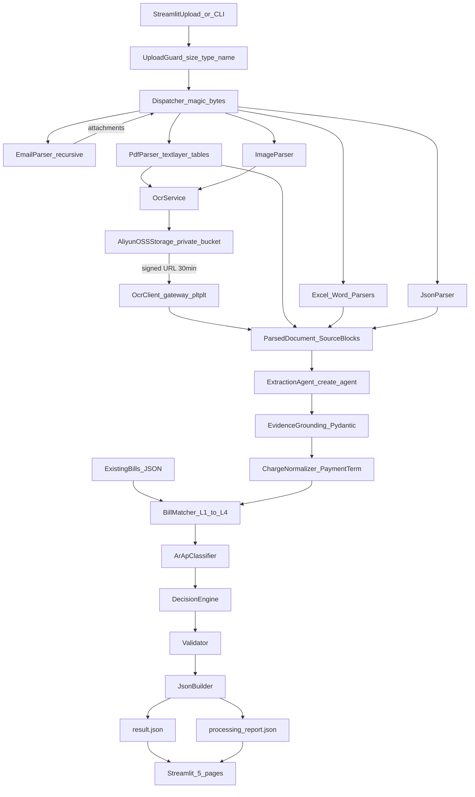
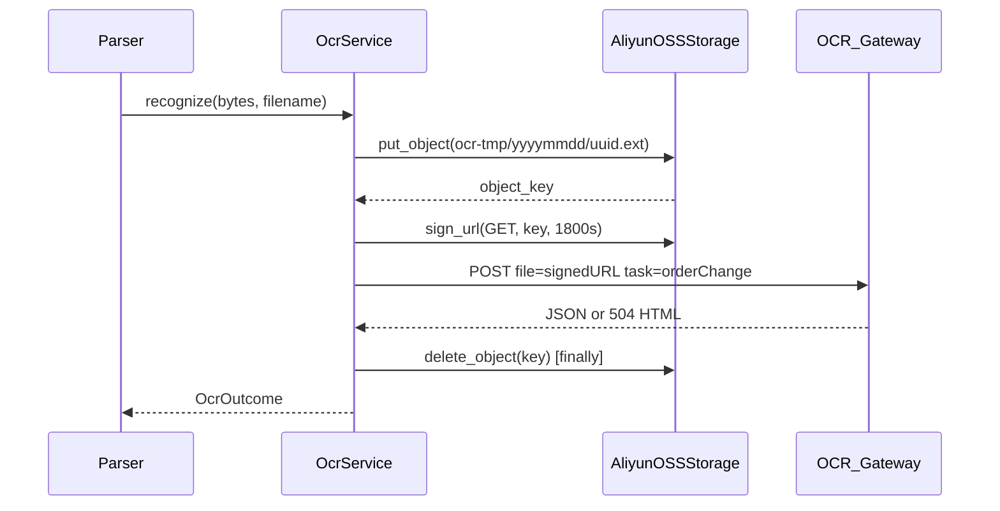
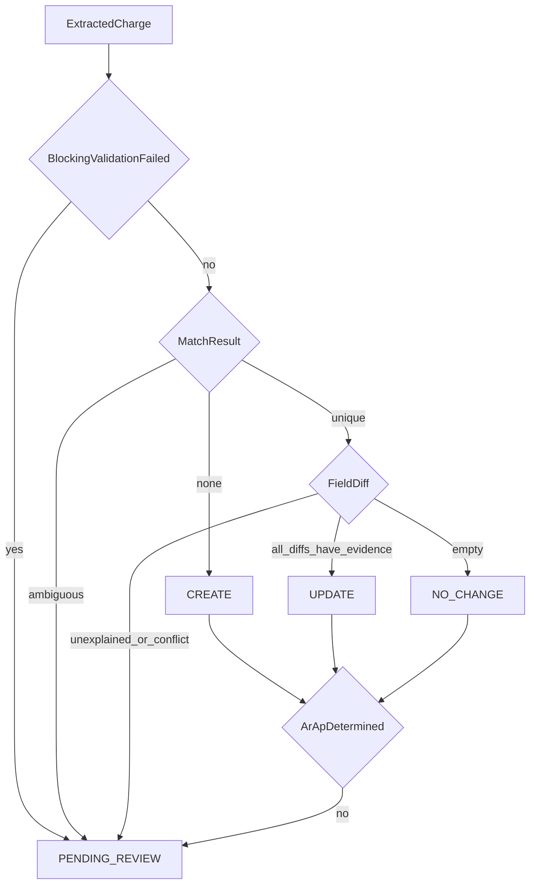

# Shipping Billing AI Agent — 系统架构

> 状态：Phase 0 设计文档。随各阶段实施更新。
> 相关文档：[requirements.md](requirements.md)、[assumptions.md](assumptions.md)、[../AGENTS.md](../AGENTS.md)

## 1. 设计原则

| 原则 | 落地方式 |
| --- | --- |
| AI 理解文档，规则保证财务正确 | LangChain Agent 只产出“带证据的候选字段”；匹配、更新、AR/AP、最终 operation 全部由 Python 规则决定 |
| 证据可追踪 | 每个解析块有稳定 `block_id`；每个提取字段携带 `evidence(block_id, quote)`，Python 回查原文 |
| 不虚构 | 缺失或无法确认 → `null`；高风险 → `PENDING_REVIEW` |
| 真实与模拟严格分离 | OCR/LLM/OSS 未配置时状态为 `NOT_CONFIGURED`，UI 显式标注 Demo Mode；Mock 只出现在单元测试 |
| 交付 JSON 稳定 | 交付 JSON 严格 6 个字段块；内部追踪信息放独立 `processing_report.json` |

## 2. 总体流程



确定性 Python 工作流负责：文件识别、解析、OSS 上传、OCR 调用、清理、校验、决策。
LangChain Agent 只在“文档语义理解与结构化提取”这一步介入。

## 3. 目录结构

根目录 `app.py` 是 Streamlit 入口；为避免与 `app/` 包同名导致导入歧义，核心包命名为 `billing_agent/`。

```
shipping-billing-agent/
├── app.py                         # streamlit run app.py
├── requirements.txt / requirements-dev.txt
├── .env.example  .gitignore  README.md  AGENTS.md
├── .streamlit/config.toml         # 蓝白灰主题
├── billing_agent/
│   ├── config.py                  # Settings（环境变量）
│   ├── schemas.py                 # 全部 Pydantic 模型
│   ├── security.py                # 文件名清洗、大小限制、URL 校验、日志脱敏
│   ├── pipeline.py                # 端到端编排 + 阶段回调
│   ├── cli.py                     # python -m billing_agent.cli
│   ├── parsers/
│   │   ├── dispatcher.py          # 魔数识别 + 分发 + 递归深度控制
│   │   ├── email_parser.py  pdf_parser.py  image_parser.py
│   │   ├── excel_parser.py  word_parser.py  json_parser.py
│   ├── services/
│   │   ├── oss_storage.py         # AliyunOSSStorage（FileUrlProvider 实现）
│   │   ├── ocr_client.py          # OcrClient（HTTP 契约）
│   │   ├── ocr_service.py         # 上传→签名 URL→OCR→删除 的编排
│   │   └── llm_factory.py         # ChatOpenAI(base_url) + 能力探测
│   ├── agents/
│   │   ├── extraction_agent.py    # create_agent + tools + response_format
│   │   ├── tools.py               # Agent 工具（只读）
│   │   └── prompts.py
│   ├── business/
│   │   ├── charge_aliases.yaml    # 可扩展费用字典
│   │   ├── charge_normalizer.py  payment_term.py  currency.py
│   │   ├── date_parser.py         # 基于文件内证据的日期格式判定
│   │   ├── bill_store.py          # 已有账单 JSON 读取/校验
│   │   ├── bill_matcher.py  bill_updater.py  ar_ap_classifier.py
│   │   ├── decision_engine.py  validator.py  json_builder.py
│   └── ui/
│       ├── theme.py  state.py
│       ├── dashboard.py  document_view.py  bill_review.py
│       ├── audit_view.py  json_output.py
├── data/
│   ├── samples/                   # 招聘方真实样例（只读，不修改）
│   └── fixtures/synthetic/        # 合成数据，文件内带 "_synthetic": true / 文件名前缀 synthetic_
├── tests/
│   ├── expected/real_samples.yaml # 人工核对的真实样例期望值（含证据说明）
│   ├── unit/                      # Mock / 纯函数，默认运行
│   └── integration/               # real_ocr / real_llm / real_oss marker
├── docs/  requirements.md  architecture.md  assumptions.md
└── output/                        # 运行产物（git 忽略）
```

## 4. 统一中间结构（schemas.py）

```text
ParsedDocument
  doc_id            稳定 ID（sha256 前 12 位 + 位置）
  file_name         清洗后的文件名
  source_chain      ["mail.eml", "4055331281 MBL.pdf"]   # 来源链
  declared_type     扩展名 / MIME 声明的类型
  detected_type     魔数识别出的真实类型
  sha256, size_bytes
  status            PARSED | PARTIAL | FAILED | UNSUPPORTED
  email             EmailMeta(subject, from, to, cc, date, message_id)  # 仅 EML
  blocks[]          SourceBlock(block_id, kind, origin, page, text, table, meta)
  ocr               OcrOutcome(status, http_status, elapsed_ms, raw_response, error)
  children[]        附件 ParsedDocument（递归）
  warnings[], errors[]
```

`SourceBlock.origin` 只允许三种：

- `native`：文件自身结构（邮件正文、Excel 单元格、Word 段落、JSON）
- `text_layer`：PDF 内嵌文本层（PyMuPDF）——**不是 OCR**
- `ocr_api`：指定 OCR API 的真实响应

`OcrOutcome.status`：`SUCCESS | FAILED | NOT_CONFIGURED | NOT_APPLICABLE`。
OCR 失败时 PDF 文本层仍然保留，但其 origin 始终是 `text_layer`，UI 与报告中不会显示为 OCR 成功。

后续阶段模型：`ExtractedField(value, raw, evidence[])`、`ExtractedCharge`、`ExtractionResult`、`BillRecord`、`MatchResult`、`FieldChange`、`Decision`、`ProcessingResult`、`OutputRecord`。金额内部一律 `Decimal`，仅在 `JsonBuilder` 序列化为 JSON number。

## 5. OCR 链路（OSS → 签名 URL → OCR）



- `FileUrlProvider` 协议：`put_temporary(bytes, suffix) -> TempObject(url, key, expires_at)`、`delete(key)`。`AliyunOSSStorage` 为真实实现；单测用内存 Fake。
- 未配置 OSS 时 `OcrService` 返回 `NOT_CONFIGURED`，不会把本地路径传给 `file`。
- `OcrClient` 校验：URL 必须 `https://`、主机非私网/回环、非本地路径；响应必须是 JSON、`success == true`、`data.list` 为数组；HTML/504/超时/非 JSON 均映射为 `FAILED` 并保留 HTTP 状态与截断错误文本。
- 日志只记录对象 key 的哈希与 HTTP 状态，不记录签名 URL 与账单内容。
- 已验证契约见 [assumptions.md §3](assumptions.md#3-已验证的接口信息)。

## 6. LangChain Agent（单 Agent）

- 构建：`langchain.agents.create_agent(model, tools, system_prompt, response_format=ExtractionResult)`
- 模型：`langchain_openai.ChatOpenAI(model, base_url, api_key)`，OpenAI 兼容接口均可。
- 启动时 `llm_factory.probe_capabilities()` 用真实请求探测 Tool Calling 与 Structured Output，不支持则报错并在 UI 显示，不降级为伪结果。
- 工具（全部只读、确定性）：

| 工具 | 作用 |
| --- | --- |
| `search_document(query)` | 在当前文档全部 SourceBlock 中检索关键字，返回 block_id + 片段 |
| `get_block(block_id)` | 读取完整块文本/表格 |
| `lookup_charge_alias(raw_name)` | 查询确定性费用字典，返回标准名或 `UNKNOWN` |
| `verify_evidence(block_id, quote)` | 确认引用片段确实存在于原文 |

- 输出：`ExtractionResult`，每个字段带 evidence；每条费用标注 `nature ∈ {actual, conditional, informational, total, tax, waived}`；邮件中的明确变更意图输出为 `ChangeRequest(field, new_value, evidence)`。
- Python 侧二次校验：evidence 回查失败的字段置 null 并记录；只有 `nature=actual`（以及已明确的 tax 行，按需求单独处理）进入后续流程。

## 7. 业务规则引擎

### 7.1 决策顺序



### 7.2 匹配（严格 L1→L4）

| 级别 | 键 |
| --- | --- |
| L1 | reference_no + 标准费用名 |
| L2 | bl_no + 标准费用名 + currency |
| L3 | booking_no + 标准费用名 + currency |
| L4 | container_no + 交易双方 + document_date + amount |

- 某级任一键字段缺失 → 记录 `SKIPPED(reason)`，进入下一级。
- 唯一命中 → 停止；多候选 → 用**非金额**的明确证据消歧（箱号、提单号、订舱号、单据日期、付款条款、明细行号映射）；金额只能作为辅助证据，不能作为唯一依据；仍不唯一 → `PENDING_REVIEW`。
- 同一已有账单在一次运行中只能被一个费用认领，重复认领 → 双方都 `PENDING_REVIEW`。

### 7.3 更新

以已有账单深拷贝为基础，只修改有证据的字段（`ChangeRequest` 或匹配后同来源明确的新值），输出 `FieldChange(field, old, new, evidence)`；字段白名单：amount、currency、payment_term、document_date、quantity、unit_price。

### 7.4 AR/AP

从 `accounting_entity` 视角：实体 == 收款方 → AR；实体 == 付款方 → AP。  
优先证据（`payment_direction.extract_payment_direction`）：`Remit to` / `Beneficiary` / `Please Pay` / `TOTAL … TO BE PAID` + Consignee / GENERAL NOTICE 收件人；强线索存在时 **覆盖** LLM 的 issuer/recipient。  
回退证据：`BALANCE DUE TO`、签发方、Bill To / recipient。实体名经规范化 + 可配置别名比较；无证据或冲突 → `posting_type=null` + `PENDING_REVIEW`。单据类型（Debit/Credit Note）只作辅助证据，**不得单独决定 AR/AP**。

### 7.5 校验清单

金额 Decimal 有效性；ISO 4217（`$` 等符号不自动换算）；明细合计 = 文档合计；OCR 易混淆字符 + ISO 6346 箱号校验位；重复行检测（同来源同一行才算重复）；多来源冲突（正文 vs 附件、OCR vs 文本层）；关键字段缺失；更新白名单；输出 Pydantic 校验；幂等指纹 `sha256(file) + line_index + normalized_key`。

## 8. Streamlit 五页面

| 页面 | 关键内容 | 数据来源 |
| --- | --- | --- |
| Dashboard 工作台 | 多文件上传、已有账单 JSON、accounting_entity、启动按钮、`st.status` 实时阶段、统计卡片、错误/警告、服务配置状态与 Demo Mode 横幅 | `pipeline.run()` 回调 + `ProcessingResult` |
| 文档解析中心 | 文件树（含附件）、预览、邮件头/正文、OCR 原始 JSON、文本层、表格、提取字段与证据并排 | `ParsedDocument` + `ExtractionResult` |
| 账单核对中心 | 费用明细表 + operation/AR/AP 筛选、新旧账单对比与变化字段高亮、匹配依据、冲突提示、人工复核标注（仅会话内） | `Decision` + `FieldChange` |
| AI 决策与审计 | 标准化依据、匹配规则链、AR/AP 证据、校验结果、处理时间线、复核原因 | `processing_report` |
| JSON 输出中心 | 最终 JSON 预览、Pydantic 校验结果、下载 result.json / processing_report.json、摘要 | `JsonBuilder` |

UI 只调用 `billing_agent.pipeline`，不实现业务规则；状态存于 `st.session_state`。

## 9. 安全

- 上传：单文件默认 ≤ 20 MB、总量 ≤ 100 MB、扩展名白名单 + 魔数复核；文件名去路径、去控制字符、限长。
- EML：递归深度 ≤ 3，附件数 ≤ 30；不执行任何附件内容。
- 临时文件：`tempfile.TemporaryDirectory`，用后即删；OSS 临时对象 `finally` 删除 + 生命周期规则兜底。
- 密钥：只从环境变量读取；`.env` 被 git 忽略；日志脱敏（签名 URL、AccessKey、银行账号）。
- 不写回原始账单文件；人工复核只改变会话状态。

## 10. 分阶段计划与验收

| 阶段 | 内容 | 验收标准 |
| --- | --- | --- |
| Phase 0 | 需求分析、样例分析、架构、假设、覆盖矩阵 | 本文档 + assumptions.md + 期望值文件 |
| Phase 1 | 解析器、Dispatcher、OSS 适配器、OCR Client/Service、安全工具 | 4 个真实样例全部解析出带来源链的块；EML 两个 octet-stream 附件被识别为 PDF 并解析；合成 xlsx/xls/docx/json 读出表格；OCR/OSS Mock 单测通过；真实 OCR/OSS 状态如实报告 |
| Phase 2 | llm_factory、能力探测、create_agent + 工具 + ProviderStrategy 结构化输出、证据回查、H/C 上下文映射、OCR chargeList 过滤 | 单元测试覆盖工具/grounding/映射/OCR 过滤；真实 LLM 需配置 `.env` 后跑 `pytest --run-real -m real_llm`（当前 BLOCKED） |
| Phase 3 | 标准化、匹配、更新、AR/AP、决策、校验、JSON 生成 | requirements §15 场景 5–19 全部单测通过（使用合成账单） |
| Phase 4 | Streamlit 五页面接入真实 pipeline | `streamlit.testing.v1.AppTest` 端到端 + 浏览器人工走查截图 |
| Phase 5 | 全量测试、README、设计思考、示例输出、打包 | AGENTS.md §17 逐条核对，分类报告测试状态 |

## 11. 测试分层

| 层 | 位置 | 运行方式 | 外部依赖 |
| --- | --- | --- | --- |
| 单元测试 | `tests/unit` | `pytest` | 无（Mock/Fake） |
| 真实样例解析 | `tests/unit/test_real_samples_parsing.py` | `pytest` | 无（只读 `data/samples`） |
| 真实 OCR | `tests/integration -m real_ocr` | 需 OSS + 网络 | OSS、OCR |
| 真实 OSS | `tests/integration -m real_oss` | 需 OSS 凭证 | OSS |
| 真实 LLM | `tests/integration -m real_llm` | 需 LLM Key | LLM |
| UI 端到端 | `tests/e2e` | `pytest` + AppTest | 视配置 |

外部依赖缺失时测试 `skip` 并在报告中标记 `BLOCKED`，不计为 PASSED。
